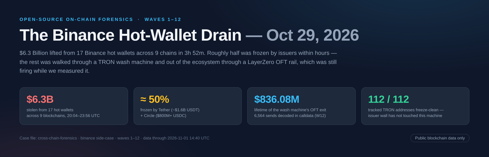
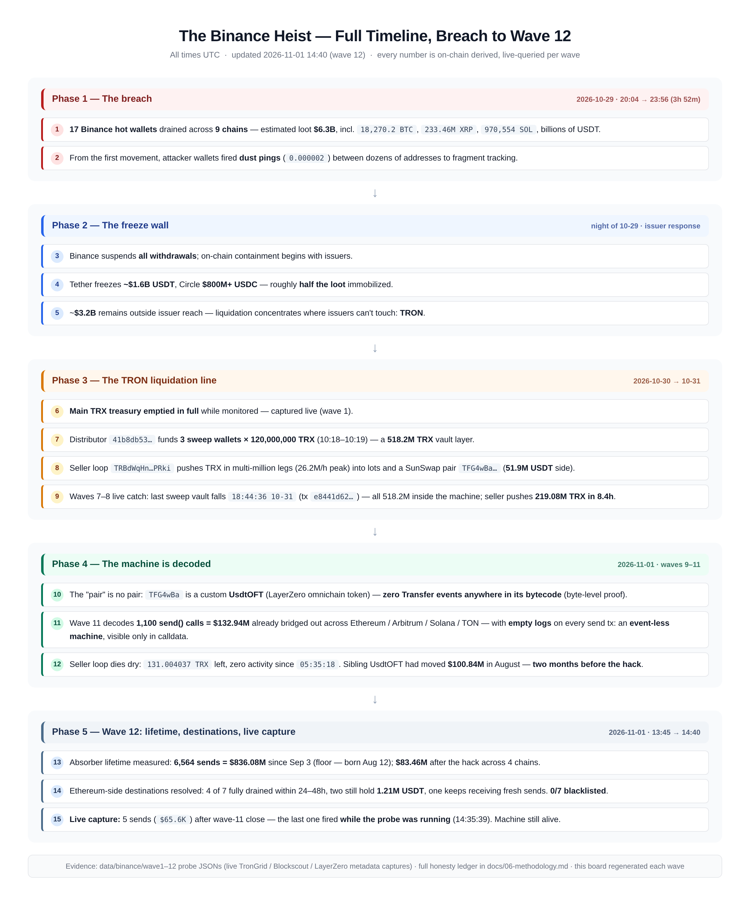
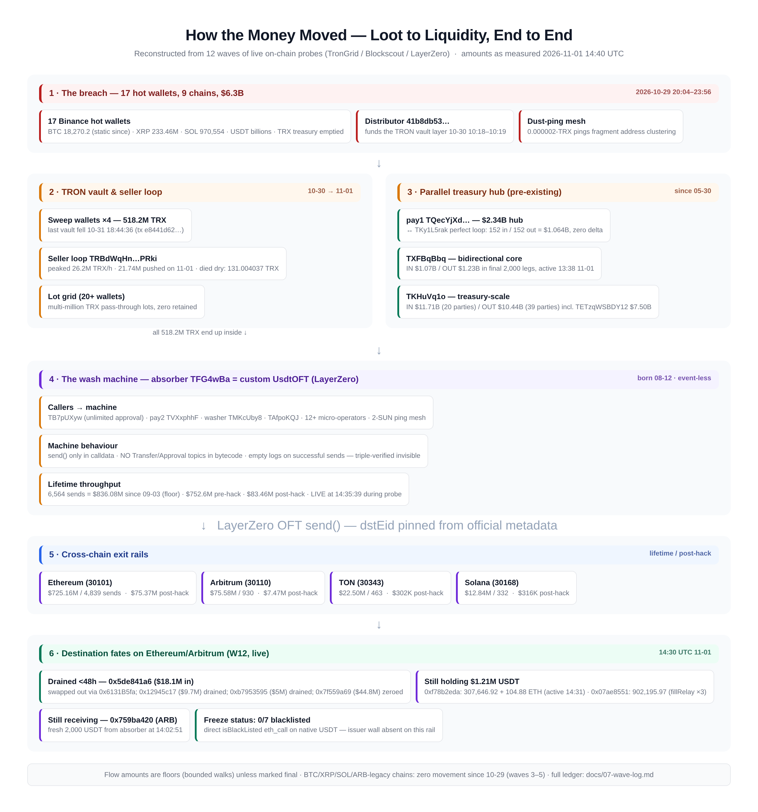
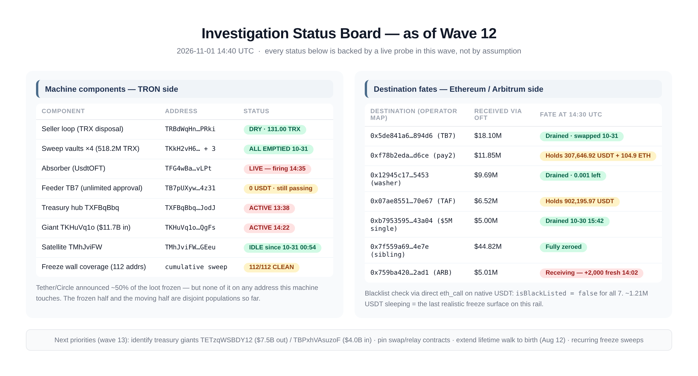
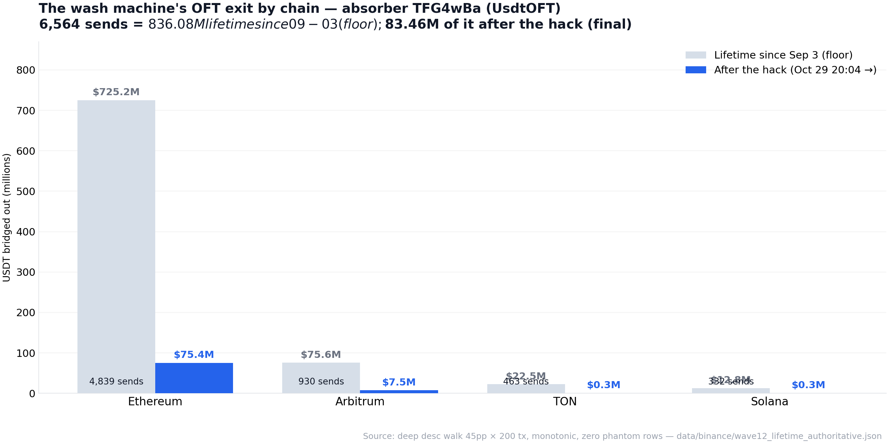

# Binance Heist 2026 — Open-Source On-Chain Forensics

   

**On 2026-10-29, between 20:04 and 23:56 UTC, $6.3 billion was lifted from 17 Binance hot wallets across 9 blockchains.**
This repository is a complete, reproducible, start-to-finish reconstruction of what happened next — built entirely from **public blockchain data**, in 12 consecutive investigation "waves", each one closing with published evidence files.

> Roughly half of the loot was frozen by issuers within hours (Tether ~$1.6B USDT, Circle $800M+ USDC). The other half walked through a TRON wash machine — a seller loop that drained to dry in 51 hours — and left the ecosystem through a **custom LayerZero OFT contract** that carries **no ERC20 events at all**, making it invisible to standard indexing. We decoded it anyway. **It was still firing while we measured it.**

---

## Table of Contents
1. [Key findings](#key-findings)
2. [Visual dossier](#visual-dossier)
3. [The twelve waves](#the-twelve-waves)
4. [Repository structure](#repository-structure)
5. [Methodology & integrity](#methodology--integrity)
6. [Data](#data)
7. [Social kit](#social-kit)
8. [Disclaimer](#disclaimer)
9. [Citation](#citation)

---

## Key findings

| # | Finding | Number |
|---|---------|--------|
| 1 | Loot stolen from 17 hot wallets / 9 chains in 3h 52m | **$6.3B** |
| 2 | Frozen by issuers within hours (Tether + Circle) | **≈ 50%** |
| 3 | Main TRX treasury emptied while monitored (live catch, wave 1) | full drain |
| 4 | TRX vault layer funded then fully consumed | **518.2M TRX** |
| 5 | Seller loop `TRBdWqHn…` lifetime before dying dry | **≈ $1B-equiv TRX pushed; died at 131.004037 TRX** |
| 6 | Absorber `TFG4wBa…` = custom **UsdtOFT** with **zero ERC20 events** (bytecode-level proof) | — |
| 7 | Lifetime cross-chain exit through the machine (6,564 `send()` calls decoded) | **≥ $836.08M** |
| 8 | Of which **after** the hack (final, fully-covered window) | **$83,457,251.12** |
| 9 | Exit rails: Ethereum / Arbitrum / TON / Solana (LayerZero eids 30101/30110/30343/30168) | $725.2M / $75.6M / $22.5M / $12.8M |
| 10 | EVM destination fates: 4 of 7 drained < 48h; 2 still hold **1.21M USDT**; 1 still receiving | 0/7 blacklisted |
| 11 | Tether freeze coverage across **every address this machine touches** | **112 / 112 clean** |
| 12 | Dormant chains since the breach (BTC 18,270.2 · XRP 233.46M · SOL 970,554) | **zero movement** |

**The headline insight:** the frozen half and the moving half of this theft are **two disjoint populations**. The issuer freeze wall has not touched a single address on the machine's visible layer — and the machine was a **$750M-scale cross-chain rail for months before the hack**, then repurposed and intensified after it.

---

## Visual dossier

All exhibits are regenerated each wave from live probes (HTML/CSS sources included under [`exhibits/src/`](exhibits/src/)).

<p align="center"></p>

| Exhibit | What it shows |
|---|---|
|  | **01 — Full timeline**: breach → freeze wall → TRON liquidation line → machine decoded → wave-12 live capture |
|  | **02 — End-to-end fund flow**: loot → vaults → seller loop → absorber → LayerZero rails → destination fates |
|  | **03 — Status board**: every machine component and destination, live state |
|  | **04 — OFT exit by chain**: lifetime vs post-hack |

---

## The twelve waves

| Wave | Date (UTC) | Headline |
|------|-----------|----------|
| 1 | 10-29/30 | Breach scoped; **main TRX treasury emptied live** under monitoring |
| 2–3 | 10-30 | TRON layer mapped; differential baseline set: 518.2M TRX vaults, seller loop, SunSwap pair, dormant chains; §next-wave plan published |
| 4–6 | 10-30/31 | Vault & lot census deepened *(early case folder lost in a session incident — results survive through later-wave baselines, disclosed honestly)* |
| 7 | 10-31 | **Live probe**: 120M TRX relay cadence (~7h) hash-pinned ×3; pair skimmed −7.15M USDT off-events |
| 8 | 10-31 | **Last vault falls 18:44:36**; seller pushes 219.08M TRX in 8.4h (26.2M/h); freeze sweep 46/46 |
| 9 | 11-01 | Absorber decoded — no getReserves/token0/token1; spender == absorber (86 approvals / 28 wallets); **≥ $54.13M exited with zero events**; freeze 57/57 |
| 10 | 11-01 | Bytecode named it: **UsdtOFT**, 22,646 B, **no Transfer/Approval topics anywhere**; pay1 = $2.34B pre-hack hub; freeze 84/84 |
| 11 | 11-01 | **1,100 send() calls ABI-decoded = $132.94M** across 4 chains (eids pinned from LayerZero metadata); seller dies dry at 131.004037 TRX; sibling UsdtOFT moved $100.84M **in August**; freeze 90/90 |
| 12 | 11-01 | **Lifetime $836.08M / 6,564 sends** (floor; born 08-12); **post-hack $83.46M final**; fates of 7 EVM destinations; **live capture at 14:35:39 during probe**; freeze 112/112 |

---

## Repository structure

```
binance-heist-2026/
├── README.md                        ← you are here
├── docs/
│   ├── 01-incident-summary.md       ← the case in one page
│   ├── 02-attack-timeline.md        ← minute-level reconstruction
│   ├── 03-the-wash-machine.md       ← TRON anatomy: vaults, seller, lots, absorber
│   ├── 04-cross-chain-exit.md       ← LayerZero OFT decode + destination fates
│   ├── 05-freeze-response.md        ← the issuer wall vs. the moving half
│   ├── 06-methodology.md            ← probes, walks, verification, honesty ledger
│   └── 07-wave-log.md               ← full W1–W12 ledger
├── data/
│   ├── addresses.csv                ← curated address catalog (role + status)
│   ├── events.csv                   ← timeline events
│   ├── absorber_sends_summary.csv   ← per-chain OFT aggregates
│   ├── ioc_wave11.csv / ioc_wave12.csv  ← machine-readable IOC rows
├── exhibits/                        ← visual dossier (PNG, regenerated per wave)
│   └── src/                         ← HTML/CSS sources + render script
└── social/                          ← ready-to-post Twitter thread + LinkedIn post
```

---

## Methodology & integrity

- **Everything is public blockchain data** — TronGrid, Blockscout v2, direct `eth_call`, LayerZero official metadata. No leaked, private, or insider data.
- **Bounded walks, floors not ceilings** — every total is explicitly a minimum ("floor"); windows are declared; accounting deltas are closed to fees or explained.
- **Triple-verified invisibility** — the OFT exit is proven event-less three ways: ≥$54.13M missing from TRC20 index (W9), no event topics in bytecode (W10), empty logs on successful sends (W11).
- **A published honesty ledger** — every self-caught error is corrected in writing *before* delivery. Recent entries: #B11 (eid map corrected pre-publication; 30101 = Ethereum), #B12 (ascending-fingerprint pagination on TronGrid invalidated after it produced mid-walk page drops **and a phantom future-dated tail** — proven fake and re-measured with a descending walk).
- Full methodology: [`docs/06-methodology.md`](docs/06-methodology.md).

---

## Data

Machine-readable artifacts live in [`data/`](data/). Larger raw probe JSONs (one per probe, per wave) are maintained in the working repo and published alongside each wave.

| File | Contents |
|---|---|
| `addresses.csv` | 25 curated addresses: chain, role, live status as of 2026-11-01 14:40 UTC |
| `events.csv` | Minute-level incident timeline |
| `absorber_sends_summary.csv` | Per-chain OFT lifetime / post-hack aggregates |
| `ioc_wave11.csv`, `ioc_wave12.csv` | 79 rows of indicators (addresses, contracts, roles, freeze status) |

---

## Social kit

Ready-to-post threads with hashtags for Twitter/X and LinkedIn are in [`social/`](social/) — texts are data-checked against this README.

---

## Disclaimer

This project is **independent security research** built solely from public on-chain data. It is not affiliated with, endorsed by, or reviewed by Binance, Tether, Circle, or LayerZero. Addresses are pseudonymous by design; nothing here asserts the legal identity of any actor. Amounts are floors measured at the stated timestamps, not court-grade balances. If you represent an exchange or issuer and can add context (tags, freezes, returns), open an issue — corrections with evidence will be merged and credited.

**Use at your own risk. Nothing here is financial, legal, or investigative advice.**

---

## Citation

```bibtex
@misc{binance_heist_2026_forensics,
  title  = {Binance Heist 2026 — Open-Source On-Chain Forensics (12-Wave Reconstruction)},
  author = {DefiAudit0x},
  year   = {2026},
  url    = {https://github.com/DefiAudit0x/binance-heist-2026},
  note   = {Public-blockchain-only investigation; data through 2026-11-01 14:40 UTC}
}
```

*Keywords: blockchain forensics · on-chain analysis · crypto hack · TRON · USDT · LayerZero · OFT · incident response · OSINT · threat intelligence*
